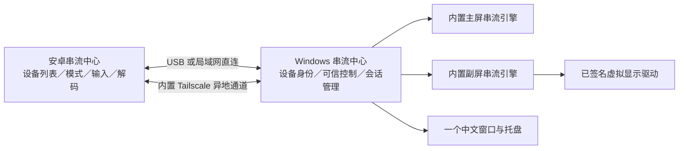

# 串流中心：产品集成方案

日期：2026-11-02。状态：需求范围已确认；本文为实施方案，不代表功能已经完成。

## 1. 最终交付是什么

将已经部署成功的远程串流、远程控制、无线副屏、USB 有线副屏整合为一个产品。Windows 安装一个中文安装包，安卓手机和平板安装同一个 APK；产品自行管理所需组件、配置、驱动、服务和更新。完成替代验收后，可卸载独立安装的 Sunshine、Tailscale、Moonlight／Artemis。

| 设备 | 本轮产品角色 | 主要操作 |
|---|---|---|
| Windows 电脑 | 被控主机、桌面扩展发起端 | 后台待机；允许手机／平板远程操作；选择在线平板作为扩展副屏 |
| 安卓手机 | 电脑的控制端、串流接收端 | 登录和绑定电脑；远程查看、触摸操作、输入文字和组合键 |
| 安卓平板 | 电脑的控制端、串流接收端、副屏接收端 | 远程主屏、无线副屏、USB 有线副屏；跟随横竖屏变化 |

用户已明确排除“电脑远程控制安卓”和“手机远程控制平板”。安卓无需开发被控端。Windows 本轮集中完成已部署的主机功能，不另增 Windows 接收串流客户端。

所有产品名称、安装器、用户界面、托盘和正常操作提示使用中文。内部协议、第三方归属、源码标识和必要诊断名称保留原名。

## 2. 用户日常怎么用

首次安装：

1. 电脑安装“串流中心”，安装向导部署内置组件及已签名的虚拟显示驱动，配置开机启动和必要防火墙规则。
2. 手机／平板安装“串流中心”。局域网可直接用配对码绑定；异地连接在各端通过浏览器完成 Google／Tailscale 身份授权。
3. 在串流中心内完成一次设备绑定确认，电脑在列表中只出现一次。底层主屏、副屏的协议配对由产品协调，用户无需分别打开 Sunshine 网页。
4. 安卓按系统要求确认 VPN 授权；需要完整快捷键转发时，再启用输入辅助权限。USB 网络共享按设备系统要求开启。

日常使用：

- 手机／平板点选电脑，再点“远程控制”或“用作副屏”。
- 电脑也可以选中已绑定、在线待机的平板，发起“用作副屏”；平板端收到请求并启动接收会话。
- 安卓应用在前台或允许的待机服务中，可按已授权策略接受请求。安卓被系统强制停止或限制后台启动时，提示用户打开应用，不能承诺所有厂商都能直接后台唤起全屏画面。
- 副屏模式在 Windows 中建立扩展桌面，可选择无线或 USB；“自动”优先健康的 USB，其次局域网，最后异地通道。
- 连接变化时先检查链路并恢复会话；切换链路可能短暂重连，第一版不要求无缝切换。
- Windows 启动后后台待机，桌面只有一个产品托盘入口；双击程序唤起同一窗口，关闭窗口收起。托盘明确区分“关闭界面”和“停止远程服务”，避免关闭窗口意外中断无人值守。

“登录一次”指每台设备首次完成身份授权，之后保存登录状态；“配对一次”指每对设备首次确认信任。账号撤销、密钥过期、重装等情况下，按实际状态提示重新授权，不在每次连接时重复登录。

## 3. 集成方式：复用成熟内核，补齐产品层

| 能力 | 复用部分 | 本产品新增部分 |
|---|---|---|
| Windows 画面采集、NVENC 编码、远程输入 | Sunshine 源码及现有可用配置 | 内置部署、服务监督、模式控制、恢复、配对适配 |
| 安卓硬件解码、串流、触控 | 现有 Artemis／Moonlight 修改版 | 统一设备列表、模式入口、内置组网、输入面板、四方向控制 |
| 异地组网、穿透、加密、中继 | Tailscale 开源客户端内核及其现有服务 | 同产品启动、身份状态显示、设备筛选、连接管理 |
| Windows 扩展桌面 | 现有已签名 VDD 驱动 | 安装修复、显示配置、生命周期、分辨率及方向管理 |
| USB 有线副屏 | Android USB 网络共享及 Windows USB 网卡 | 链路发现、路由选择、断线检测、恢复 |
| 统一体验 | 现有 WPF 和安卓工程 | 产品设备身份、一次绑定、可信控制通道、安装迁移、更新回滚 |

第一版保留两份内部串流配置／工作进程，分别服务主屏和副屏，保护已经可用的画面及音频行为。两者均安装在本产品目录下，由本产品维护；不再查找外部 `SunshineService` 或 `C:\Program Files\Sunshine-Tablet`。

“一个软件”对应一个安装产品、一个设备入口、一个账号流程和一个托盘，不要求所有内核挤进一个进程。首版按每台安卓设备一个活动模式设计；主屏与副屏切换可由产品自动重建会话，多客户端并发和单编码实例热切屏另行验证。

## 4. 统一登录、设备和配对

首版推荐继续使用 Tailscale 的现有个人账号服务，产品内置其客户端能力；不先开发独立云账号、协调服务器和全球中继。Google 是上游登录方式，身份凭据交由其授权流程处理，不复制用户密码或把管理密钥写进安装包。

Windows 侧验证将组网守护进程、所需虚拟网卡组件、状态目录纳入本产品服务。安卓侧优先复用官方 `tailscale-android` 的 Go／AAR 与 `VpnService` 集成方式，将网络模块编入同一个 APK，而不是检测和拉起另一个 Tailscale 应用。官方已有 `gomobile bind` 生成 `libtailscale.aar` 的构建路径；交互登录优先复用 `StartLoginInteractive`／`BrowseToURL` 并监听登录状态，不依赖原 Tailscale APK 的专用回调。

开源客户端可以复用，不等于上游云服务、授权回调和发布条件已经全部验证。早期必须完成真实 Google 登录、客户端注册、发现、UDP 串流验证，并核对发行条件。若官方服务集成不可行，需修订网络方案；不能交付一个依赖外置 Tailscale 的版本却宣称完全替代。

产品为 Windows 主机生成一个持久设备 ID，将主屏、副屏端点挂在这个 ID 下。网络地址变化只更新路由，不新增设备卡片。设备能力、可用模式、方向和会话请求通过经过绑定认证的控制通道交换。

设备登录与“允许远控”分开处理：首次绑定使用配对码或等效的显式信任确认；主机再协调两个内部串流端点的证书配对。保留客户端自己的私钥，按各后端协议登记公钥／证书，不靠复制整个 Sunshine 状态、共享主机私钥或关闭认证来合并设备。加入同一个网络也不自动获得远控权限。

安卓通常只能同时运行一个 VPN。首次 Google 登录安排在启用内置隧道之前，兼容用户先用原有 VPN 打开授权页的情况；授权完成后再切换。若无法同机顺利授权，验证通过电脑浏览器打开设备授权链接并由客户端确认登录状态的流程。

## 5. 无线和 USB 的数据通路

无线副屏优先走宿舍局域网，异地远控走内置组网；尽量直连，无法直连再用上游中继。界面显示实际使用的链路及连接质量。中继带宽和校园网限制会影响最高画质，不保证所有网络都能跑满近 4K／90Hz。

USB 首版使用现有标准 IP 串流路线：USB 网络共享生成网卡，应用选择该网卡承载控制、视频和输入。正常使用不需要 ADB 或开启 USB 调试，关闭 Wi-Fi 后仍应能接通副屏，以确认流量确实走线。

普通安卓应用无法保证静默打开 USB 网络共享，安装向导需针对平板系统给出设置入口。不能把“开启共享后可用”宣传成所有机型都能无条件插线即用。如果未来需要完全自动的 USB 配件模式，再单独评估 AOA／WinUSB 传输；它不阻塞第一版集成。

对插拔、链路失效和 USB 设备重置分别处理。降低码率可缓解网络拥塞，不能修复 Windows 的 USB 识别警告或线材／端口复位。

## 6. 副屏、画质和输入策略

副屏按接收设备的显示模式和解码能力协商分辨率、刷新率与方向，不固定为某一款平板。启动时检测实际解码能力和显示模式，不能仅凭屏幕刷新率认定视频已经达到 90fps。HEVC 硬件编解码优先；迁移起步使用此前稳定的 15Mbps，再依据实测增加“稳定／清晰／自定义”档位。

画质和延迟分别测量：视频有效帧率、网络抖动／丢包、编码、解码、渲染、输入响应。降码率与降帧率分开，网络拥塞优先调整码率，解码／渲染能力不足再调整分辨率或帧率，不承诺未经测量的固定毫秒数。

方向消息明确包含 0／90／180／270 度、当前视频尺寸和应用窗口尺寸。主机检查活动副屏身份，过滤旋转抖动后调整虚拟显示，再协商视频尺寸；如引擎不能在会话中更改，自动短暂重连。两种竖屏必须分别验证画面和触控坐标，不能只交换宽高。手动锁定方向、安卓分屏和浮窗也需有明确行为。

副屏默认关闭串流音频，不改 Windows 默认播放设备，保持用户当前选择的 Realtek 扬声器或耳机。远程主屏可单独选择电脑播放／安卓播放。迁移时保留现有音频策略，不能每次连接都强制切回某一张声卡。

输入功能包括可随时打开的中文输入面板、屏幕键盘入口、Ctrl／Alt／Shift／Win 组合键、常用快捷键按钮、外接键盘转发。必要时通过无障碍过滤系统快捷键；具体可拦截的按键受安卓版本和厂商系统影响，尤其是 Alt+Tab，需在用户平板上验证后说明支持范围。

副屏按需启用和编码，空闲时停止不必要的串流工作。资源占用记录空闲、远控、副屏三个状态的实测值，再决定优化，不预先承诺内存数字。

## 7. 开发阶段与完成门槛

| 阶段 | 工作 | 完成后可验证的结果 |
|---|---|---|
| 0：关键路径验证 | 安卓内置组网、真实登录、同 APK 媒体流路由；Windows 内置组网服务；产品授权协调两后端；USB 不用 ADB | 证明目标可以只依赖一个安装产品，及早发现账号、VPN、协议限制 |
| 1：电脑完整安装包 | 产品目录、后台服务、内置两串流后端、VDD、规则、日志、修复和回滚 | 独立 Sunshine 不运行时，串流中心能自行启动主屏和副屏 |
| 2：安卓统一客户端 | 手机／平板共用 APK，一个设备卡片、一次绑定、模式切换、接收副屏请求 | 局域网内完成远控及扩展副屏闭环 |
| 3：账号与异地整合 | 正式接入通过阶段 0 的组网模块，保存授权、发现设备、显示直连／中继状态 | 电脑和平板仅运行串流中心，通过不同网络远程接通 |
| 4：有线及操作完善 | USB 选路、四方向旋转、音频、中文输入、组合键、重连、自启 | 真机完成有线／无线副屏和远程办公的完整操作 |
| 5：替代交付 | 正式签名、版本更新、停用旧软件测试、升级回滚、连续稳定性测试 | 安装包和 APK 能独立交付，通过后再迁移卸载原软件 |

阶段 0 的技术检查必须覆盖：

- 安卓内置 VPN 不将自身串流流量排除；Go 组网底层 socket 正确绕过隧道，避免路由循环。
- 一个 APK 内 Moonlight 的 TCP／UDP、控制、输入和音视频都实际经过目标链路。
- 自有包名、Windows 服务和浏览器授权的注册／回调／登录状态恢复真实可用，不采用硬编码临时授权密钥充当正式流程。
- 一次产品授权可完成两个后端各自的合法配对，模式切换不要求用户再输第二次码。
- 无 USB 调试时可通过 USB 网卡建立视频会话；平板作为接收端能收到电脑发来的启动副屏请求。

开发阶段在独立产品目录和隔离配置中验证，避免破坏现在能用的部署。当前不需要插线或打开 ADB；到真机安装和有线验证时再通知用户。

## 8. 安装、迁移和更新

正式程序安装到 `C:\Program Files\StreamHub`；共享运行配置和日志放 `C:\ProgramData\StreamHub`，用户设置放用户本地应用数据目录。PC 实测发现当前 Sunshine 内核无法转换中文物理路径，因此内部目录使用英文；可执行文件、安装器、开始菜单、托盘与日常界面保持中文。

Windows 安装包应包含运行时、固定版本串流内核、组网组件、必要虚拟网卡组件和原厂签名 VDD 安装资源，统一管理组件版本。驱动保留原有签名，不为中文改名而修改已签名文件。

升级先保存已知可用版本和配置，停止相关会话后替换；失败时回退。安卓使用固定应用 ID 和正式发布签名，支持后续覆盖升级。调试签名包和未签名 Release 包不作为最终交付。

迁移顺序：记录现有画面／音频／配对／网络配置 → 产品独立部署 → 停用旧组件做替代验收 → 保留回滚备份 → 通过后卸载旧应用。新旧组网实例不同时争用同一网络状态和虚拟网卡；安卓也不同时开启两个 VPN。旧登录凭据不能无条件跨包读取，必要的一次重新登录或配对纳入迁移向导。

开机待机依靠 Windows 后台服务，托盘只提供界面，不要求窗口常开。电脑需要处于已开机、可联网状态；睡眠、关机唤醒不属于现有串流能力，锁屏／解锁／登录前可用范围需分别实测。

## 9. 最终验收清单

| 场景 | 通过标准 |
|---|---|
| 安装独立性 | 干净环境只安装本产品，即可部署依赖；没有外部 Sunshine／Tailscale 目录硬编码 |
| 账号与设备 | 各端首次登录并绑定后重启可恢复；每台电脑一张设备卡片；主屏副屏无重复用户配对 |
| 手机远控 | 安卓手机通过局域网和异地网络连接 Windows，触控、输入、键盘正常 |
| 平板远控 | 平板通过局域网和异地网络连接 Windows，文字清晰，断线后能恢复 |
| 无线副屏 | Windows 确认处于扩展桌面；可从电脑选择在线平板发起，平板正确接收 |
| USB 副屏 | USB 调试关闭；关闭 Wi-Fi 后仍能连接，流量经 USB 网卡；插拔后能发现并恢复 |
| 四方向 | 横屏、反向横屏、正竖屏、反竖屏；连接中旋转及触控坐标均正确 |
| 音频 | 副屏连接、重连、旋转后，Windows 仍保持用户选定的本机播放设备 |
| 画质与性能 | 用持续运动画面测目标分辨率与 90fps，记录实际码率、丢帧、网络／解码／渲染耗时；不足时有可用降档 |
| 启动与恢复 | Windows 重启后服务待机；单实例、一个托盘；网络变化、锁屏解锁和安卓后台恢复行为明确 |
| 连续使用 | 主要链路分别连续至少 60 分钟，并完成重复连接、插拔、方向切换；长时间无人值守另做过夜验证 |
| 替代旧软件 | 独立 Sunshine、Tailscale、Moonlight／Artemis 均停止时功能仍完整；通过后验证卸载不破坏产品 |
| 可维护交付 | 中文安装包、正式签名 APK、版本说明、许可和对应源码／构建信息、回滚和更新路径齐全 |

## 10. 费用、开源和当前基础

2026-11-02 官方 Tailscale Personal 页面标注个人非商业用途免费、Free forever、最多 6 位用户、无限用户设备。个人这几台设备优先沿用该服务，不要求先购买自建服务器；实际账户套餐及集成使用仍受其规则约束。它不等于我们独立搭建同等规模账号和中继系统也必然零成本。

复用 Sunshine、Artemis／Moonlight、Tailscale 和 VDD 的公开源码，按各组件许可证保留归属并提供相应源码／构建材料；无需为本项目去逆向收费闭源产品。产品中文化与保留上游许可归属并不冲突。

现有可复用基础：WPF 中文窗口／托盘／单实例；安卓 Artemis 修改版和两模式入口；现有串流、虚拟显示、编码及音频部署经验。当前缺口：真正内置后端与组网、产品设备身份和统一绑定、完整安装器、正式更新、产品自己的方向控制与真机验收。现有窗口不能当作最终集成完成。

参考：

- [Tailscale 当前套餐](https://tailscale.com/pricing)
- [Tailscale 开源客户端](https://github.com/tailscale/tailscale)
- [Tailscale 安卓客户端](https://github.com/tailscale/tailscale-android)
- [安卓内核 AAR 构建入口](https://github.com/tailscale/tailscale-android/blob/main/Makefile)
- [安卓 VPN 服务](https://github.com/tailscale/tailscale-android/blob/main/android/src/main/java/com/tailscale/ipn/IPNService.kt)
- [组网底层 socket 保护接口](https://github.com/tailscale/tailscale-android/blob/main/libtailscale/interfaces.go)
- [Tailscale 交互登录本地接口](https://github.com/tailscale/tailscale/blob/main/client/local/local.go)
- [Sunshine](https://github.com/LizardByte/Sunshine)
- [Artemis／Moonlight 安卓分支](https://github.com/ClassicOldSong/moonlight-android)
- [虚拟显示驱动](https://github.com/VirtualDrivers/Virtual-Display-Driver)
- [Android VpnService](https://developer.android.com/reference/android/net/VpnService)

本轮仅更新方案与说明文档，未更改现有服务、驱动、登录状态或串流配置。
